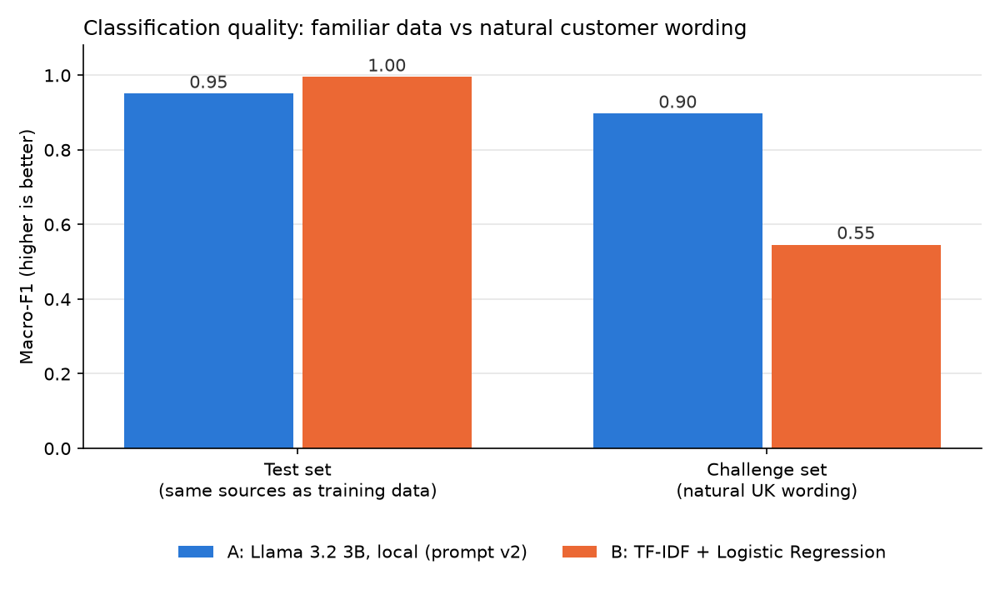

# Enterprise AI Model Benchmark

**Central question:** For a UK e-commerce company receiving ~50,000 enquiries a day,
which approach to classifying enquiries (Delivery, Refund, Payment, Product Quality, Other)
gives the best business value: a small locally run language model, or a conventional
supervised classifier?

**Short answer:** The local language model (Llama 3.2 3B via Ollama). It scored slightly
lower on data resembling the training sources, but it held up on naturally written
messages, where the supervised classifier failed because it had learned shortcuts.
Both are cheap and fast enough; accuracy on real wording drives the business cost.
→ Full recommendation for non-technical readers: [docs/recommendation.md](docs/recommendation.md)

## Results

| | A: Llama 3.2 3B (local) | B: TF-IDF + Logistic Regression |
|---|---|---|
| Test set macro-F1 (1,429 msgs) | 0.951 | **0.995** |
| Challenge set macro-F1 (60 natural UK msgs) | **0.897** | 0.546 |
| Challenge accuracy, 95% CI | 79.9–95.3% | 44.1–68.4% |
| Time per message | 57 ms (GPU) | 0.7 ms single / 0.016 ms batch (CPU) |
| Compute per day at 50k enquiries | 47.6 min | 0.8 s |
| Infrastructure per month | ~£40 | ~£0 |
| Needs company-labelled training data | No | Yes |

Confusion matrices: [reports/figures/confusion_matrices.png](reports/figures/confusion_matrices.png) ·
Error analysis: [docs/error_analysis.md](docs/error_analysis.md) ·
Cost model: [src/cost_model.py](src/cost_model.py)

## Approaches

- **A — Llama 3.2 3B via Ollama:** prompt only, no training. Prompt v2 = category definitions,
  tie-break rules and 2 training examples per class. Temperature 0. Chosen over a
  zero-shot v1 on validation (macro-F1 0.946 vs 0.815).
- **B — TF-IDF + Logistic Regression (scikit-learn):** 12 settings compared on validation;
  best (word + word-pair features, C=10) retrained on train + validation.

## Data

- **Bitext customer-support dataset** (26,872 messages, 27 intents) mapped to 4 categories.
- **Product Quality** has no Bitext equivalent → 998 messages generated with Mistral 7B
  (a different model family from the one evaluated), reviewed by hand.
- Realistic class mix (assumed): Delivery 35%, Refund 20%, Other 20%, Payment 15%,
  Product Quality 10%. Final dataset: 9,998 messages.
- **Challenge set:** 60 natural UK-English messages (12 per class, 16 ambiguous),
  used once, for robustness testing.
- Labelling rules: [docs/labelling_guidelines.md](docs/labelling_guidelines.md)

## Method: how the comparison was kept fair

- **Class imbalance:** realistic mix; macro-F1 as the main metric so small classes count equally.
- **Data leakage:** 2,237 exact duplicates removed; near-duplicates grouped and kept in one split;
  placeholders like `{{Refund Amount}}` replaced so labels weren't given away.
- **No tuning on evaluation data:** stratified, grouped 70/15/15 split. All tuning on validation.
  The test set was locked with a SHA-256 hash and used once; the hash was verified before evaluation.
- **Shortcut checks:** phrase-frequency check on synthetic data (v1 → v2) and coefficient
  inspection of the classifier.
- **Ambiguous messages:** written tie-break rules, applied in labelling and in the LLM prompt.

Every decision and its trade-off: [docs/decisions.md](docs/decisions.md)

## Key findings

1. **High test scores can be misleading.** TF-IDF reached 0.995 on the test set by learning
   the data generators' style (e.g. "just", "hello", "ordered" → Product Quality) and dropped
   to 0.546 on natural wording.
2. **The LLM's errors were mostly on boundaries we defined** (cancellation fees, address
   changes, refunds to cards). Clearer category rules would reduce them.
3. **Prompt design mattered more than anything else** for the LLM: +13 points of macro-F1 from v1 to v2.
4. **Running cost is negligible for both;** misrouted enquiries are the real cost.

## Limitations

- Training and test data are synthetic (Bitext templates, Mistral-generated); American-English source text.
- The challenge set is small and was drafted with an AI, not taken from real customers.
- TF-IDF trained on real company data would likely perform much better; this was not tested.
- Timings come from one laptop GPU (RTX 4060); cost figures are documented assumptions.

## Repository structure

    data/
      processed/      cleaned and combined dataset (raw data is downloaded, not committed)
      splits/         train / val / test + test.sha256 lock
      challenge/      hand-checked challenge set
    docs/             decisions, labelling guidelines, error analysis, recommendation
    reports/figures/  charts
    results/          predictions, metrics, cost model output
    src/              pipeline scripts (run order below)

## How to reproduce (Windows PowerShell)

    git clone https://github.com/Priyanuj1709/enterprise-ai-model-benchmark.git
    cd enterprise-ai-model-benchmark
    python -m venv .venv
    .\.venv\Scripts\Activate.ps1
    pip install -r requirements.txt
    ollama pull llama3.2:3b

    python src/download_data.py          # Bitext from Hugging Face
    python src/build_dataset.py          # map intents, clean, sample
    # src/generate_product_quality.py needs `ollama pull mistral`; its reviewed output is committed
    python src/combine_dataset.py
    python src/split_data.py             # reproduces the committed split (same hash)
    python src/train_baseline.py         # Approach B
    python src/llm_classifier.py --prompt v2   # Approach A on validation
    python src/evaluate.py               # one-time test + challenge evaluation
    python src/error_analysis.py
    python src/cost_model.py
    python src/make_summary_chart.py

## Tools and credits

Python, pandas, scikit-learn, Matplotlib, Ollama, Llama 3.2 3B (Meta), Mistral 7B (Mistral AI),
Git/GitHub. Dataset: [Bitext customer-support dataset](https://huggingface.co/datasets/bitext/Bitext-customer-support-llm-chatbot-training-dataset).
Model and dataset licences apply. See their respective pages.